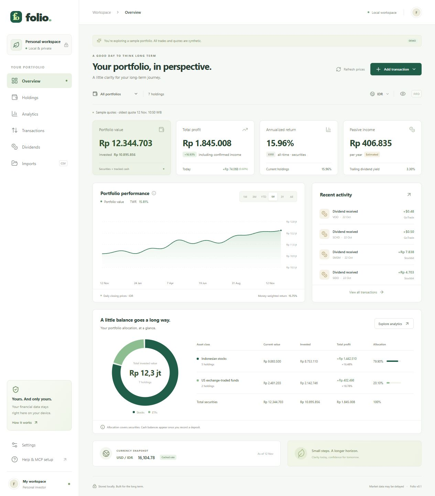

<p align="center">
  
</p>

<h1 align="center">Folio</h1>
<p align="center"><strong>Your investments, in perspective.</strong></p>
<p align="center">A private, local-first portfolio for Indonesian stocks and US ETFs.<br>One SQLite database. A clear dashboard. The same numbers in Claude.</p>
<p align="center"><code>Python + FastAPI</code> &nbsp; <code>React + TypeScript</code> &nbsp; <code>SQLite</code> &nbsp; <code>Read-only MCP</code></p>
<p align="center"><a href="#quick-start">Quick start</a> · <a href="#a-look-inside">Preview</a> · <a href="#connect-claude">Connect Claude</a> · <a href="docs/USAGE.md">Full guide</a> · <a href="SECURITY.md">Privacy & security</a></p>

---

## A look inside



<p align="center"><sub>Independent synthetic holdings, trades, income, prices, and FX. No real broker records or account balances are pictured.</sub></p>

## Your portfolio, without the spreadsheet juggling

| What you want to know | What Folio gives you |
| --- | --- |
| **What is everything worth?** | Holdings and tracked cash in IDR or USD, with explicit FX and quote timestamps. |
| **Am I making progress?** | Realized/unrealized gains, FIFO or average cost, annualized XIRR, daily TWR, and historical value charts. |
| **Where am I concentrated?** | Allocation by holding, asset class, sector, country, and currency; top weights and HHI. |
| **What income did I receive?** | Confirmed gross/net dividends, withholding tax, trailing income, and separately labeled payout estimates. |
| **Can I keep my own records?** | Manual entries, fractional US shares, explicit IDX lots, splits, custom assets, and cash movements. |
| **Can I bring my history?** | CSV preview, row-level validation, duplicate detection, import history, and protected undo. |
| **Can Claude read the same numbers?** | Eleven local MCP tools backed by the same database and analytics engine. |

### Market data: clear about its limits

Quotes come from Yahoo Finance through an isolated provider adapter. The default cache lasts **5 minutes** and refreshes on demand when a report is requested, or through **Refresh prices**. An open page does not continuously poll or stream prices. IDX is labeled delayed around 10 minutes; US quotes are provider-delayed. USD/IDR uses daily provider observations. Cached data remains available offline with warnings.

Broker transactions and confirmed dividends come from **your imports and entries**. There is no automatic broker sync or trade execution.

## Quick start

**Requirements:** Python 3.11+ and Node.js 20.19+.

```powershell
git clone https://github.com/ChrisZo11/folio-local.git
cd folio-local
.\start.ps1
```

The launcher creates a virtual environment, installs missing dependencies, builds the dashboard, and starts **http://127.0.0.1:8000**. The personal database starts empty. Add a trade or visit **Imports** to review your CSV before saving it.

Want to explore first? Stop the server with **Ctrl+C**, then run:

```powershell
.\start.ps1 -Demo
```

| Mode | Database | Starting records |
| --- | --- | --- |
| Personal | `data/portfolio.db` | Empty, ready for your imports |
| Demo | `data/demo.db` | Invented examples, explicitly labeled synthetic |

Demo records are separate from personal data and never refresh against Yahoo. The [full guide](docs/USAGE.md) includes manual setup, CSV schemas, source adapters, calculations, and backup/restore instructions.

## Connect Claude

Merge [the MCP template](claude-desktop.example.json) into your existing Claude Desktop configuration. Replace **every** `C:\path\to\folio` placeholder with your checkout's absolute path, keep any existing servers, and restart Claude. Keep the completed local configuration outside Git.

The server runs locally over stdio and works without the web app running. Portfolio-reading tools do not edit trades or confirmed income; `refresh_prices` only updates public market-data caches.

| Portfolio context | Analytics | Market & data status |
| --- | --- | --- |
| `list_portfolios` | `get_performance` | `get_quote` |
| `get_holdings` | `get_allocation` | `refresh_prices` |
| `get_transactions` | `get_concentration` | `data_status` |
| `get_portfolio_value` | `get_dividends` | |

> “What is my portfolio worth, how concentrated is it, and are any prices stale?”

Folio calculates the numbers in code. Claude explains the returned values, currencies, assumptions, and missing-data warnings.

## Privacy is part of the workflow

- **Local records:** holdings, transactions, confirmed income, and backups stay on your machine. Only public ticker symbols go to the price provider.
- **Private source:** this repository is intended to stay private. Its contents are source code, documentation, and independently invented demo assets.
- **Default-deny tracking:** personal PRDs, statements, real exports, databases, backups, environment files, credentials, caches, dependencies, and build outputs are excluded. Only reviewed source/documentation paths are allowed.
- **Checks before upload:** bundled Git hooks inspect staged files and reachable history for disallowed paths, common secrets, personal paths/emails, and unexpected binary files. Detected secret values are not printed.
- **No screenshot surprises:** the README screenshot comes from a fresh isolated demo database. Never replace it with a live account capture.

Enable the hooks once per clone:

```sh
git config core.hooksPath .githooks
python scripts/check_repository.py --history
```

A private repo and automated scans cannot guarantee that future edits contain no sensitive information. Review staged diffs and images before every push. SQLite files and backups are not encrypted by the app. See [SECURITY.md](SECURITY.md) for the exact boundaries.

## Built to be understandable

```text
CSV / manual entry ──> validated ledger ──> local SQLite
                                              ▲
Yahoo adapter ──> timestamped price & FX cache ─┤
                                              │
                                      analytics engine
                                         /         \
                                  FastAPI + React   MCP stdio
```

| Directory | Responsibility |
| --- | --- |
| `portfolio/` | Storage, validation/import, lot accounting, market adapters, analytics, HTTP API, CLI, and MCP |
| `web/` | Responsive React dashboard and entry forms |
| `tests/` | Hand-calculated finance cases, import rollback/deduplication, offline behavior, API/MCP agreement, and repository privacy checks |
| `examples/` | Explicitly synthetic CSV and JSON templates |
| `docs/` | Detailed usage and a reviewed demo screenshot |
| `scripts/`, `.githooks/` | Local commit/push privacy guards |

## Development

```powershell
.venv\Scripts\python.exe -m pip install -e ".[test]"
.venv\Scripts\python.exe -m pytest -q
npm run build --prefix web
```

For hot reload, start the backend and run `npm run dev --prefix web` in another terminal. Vite listens on **127.0.0.1:5173** and proxies `/api` to port 8000. Local API docs: **http://127.0.0.1:8000/docs**.

## Know the boundaries

Folio is an informational ledger. Reconcile imported balances, fees, dividends, and returns against your broker records before relying on them. Holdings-only openings explicitly limit return calculations; missing historical prices or FX produce unavailable metrics rather than fabricated results.

The app is local-only and has no remote login. Do not expose it to your LAN or the internet. Broker sync, tax reports, HTTP MCP, public hosting, rebalancing simulations, scheduled alerts, automatic provider fallback, and the later Growth/Metrics/Report views are outside this version.

<p align="center"><sub>Small steps. A longer horizon.</sub></p>
